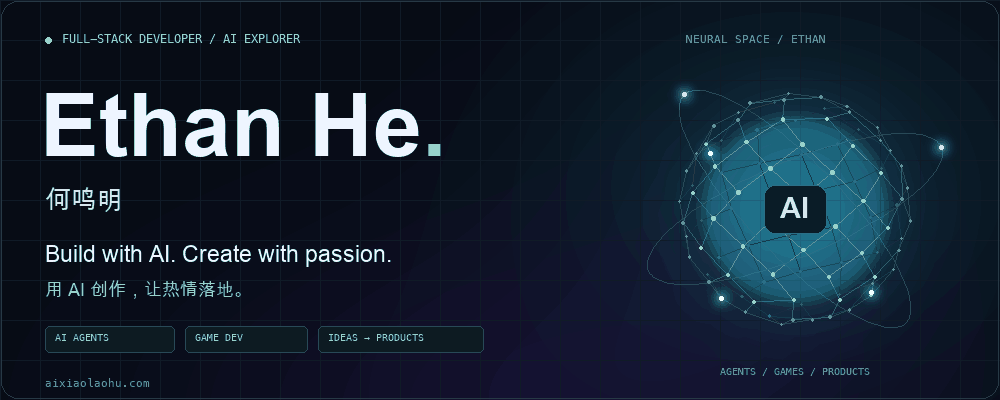

# Ethan He · 何鸣明

**Full-stack Developer · AdTech · AI Builder**  
**全栈开发 · 广告商业化 · AI 实践与探索**

Hi, I'm **Ethan He / 何鸣明**, a full-stack developer at **ByteDance**, previously at **Ctrip**.

你好，我是何鸣明，也叫 Ethan。现就职于字节跳动，此前在携程工作，从前端开发走向全栈，工作覆盖广告开放平台、移动端广告产品、开环电商广告创建与 AI 广告创编助手。

Lately, I've been fascinated by **AI entrepreneurship**: exploring ways to turn AI ideas into useful products and revenue, building AI agents, and experimenting with **making games with AI**.

最近迷上了 **AI 创业**，正在研究 **AI 产品与变现路径**、探索 **AI Agent 搭建**，也在尝试 **用 AI 做游戏**。

[Website / 个人网站](https://www.aixiaolaohu.com) · [Projects / 开源作品](https://github.com/myprelude?tab=repositories) · [Notes / 技术笔记](https://github.com/myprelude/Web-FrameWork)

## Now / 最近在做什么

- **AI entrepreneurship & monetization / AI 创业与变现** — Exploring product ideas and ways to create value with AI. 研究 AI 产品与变现路径，探索让想法产生实际价值。
- **Making games with AI / 用 AI 做游戏** — Experimenting with AI-assisted game development. 正在探索 AI 辅助游戏开发，把想法做成可以玩的作品。
- **AI agents & applications / AI Agent 与应用探索** — Building agents and exploring practical AI applications. 搭建智能体，探索 AI 的实际应用。

## Experience / 工作经历

### ByteDance / 字节跳动

2020.02 — Present / 至今

**Earlier · Frontend Development / 前期 · 前端开发**

- Built an API configuration platform with automated API documentation for the advertising open platform.  
  广告商业化开放平台：搭建接口配置平台，支持接口文档自动生成。
- Refactored and maintained the mobile DOU+ project.  
  移动端 DOU+ 项目的重构与维护。

**Later · Full-stack Development / 后期 · 全栈开发 · 非中商业化**

- Developed ad creation features for OLE open-loop e-commerce in the non-China advertising business.  
  OLE 开环电商的广告创建功能开发。
- Developed an AI ad creation assistant to help diagnose and resolve issues during ad creation.  
  开发 AI 广告创编助手，辅助排查和解决广告创建过程中的问题。

### Ctrip / 携程

2018 — 2020.02 · Frontend Development, Ground Transportation / 前端开发 · 用车部门

- Frontend development for airport transfers and customized charter services.  
  接送机、定制包车业务的前端开发。
- Integrated with Grab as part of a real-time ride-hailing project.  
  对接 Grab，参与实时打车项目。

## Selected work / 精选作品

### [VSCode-Snippet](https://github.com/myprelude/VSCode-Snippet)

Reusable VS Code snippets for common regular expressions.  
将常用正则表达式整理成 VS Code 代码片段，减少重复输入。

### [React-Hook-Library](https://github.com/myprelude/React-Hook-Library)

React Hooks concepts, practical examples and demos.  
React Hooks 的原理、用法与示例，记录技术理解与实践。

## Let's build with AI / 一起用 AI 创造新的可能

Interested in AI products, game development, agents, or exploring ways to monetize AI? Let's connect, build something fun, and turn our enthusiasm into real projects.

如果你也对 AI 创业、AI 游戏、Agent 或 AI 变现感兴趣，欢迎联系我。一起用 AI 做点有趣的事，把热情变成作品，把想法变成新的可能。

- **Website / 个人网站:** [www.aixiaolaohu.com](https://www.aixiaolaohu.com)
- **Phone / 电话:** [+86 159 5511 3400](tel:+8615955113400)

---

Build with AI. Create with passion.  
用 AI 创作，让热情落地。
